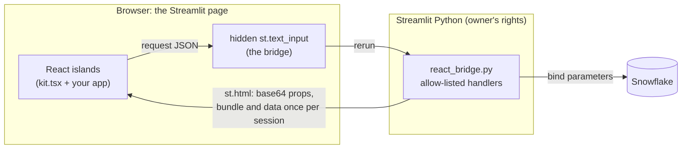

# How it works

Streamlit 1.52 added `unsafe_allow_javascript=True` to `st.html`, which runs JavaScript in the
page itself rather than in an iframe ([release notes](https://docs.streamlit.io/develop/quick-reference/release-notes)).
That is enough to mount a React app inside a Streamlit in Snowflake page while Python keeps
the Snowflake session, the queries and the permissions. Getting it to behave like a web app
takes five mechanisms. Each one below names the failure it prevents and the test that shows it.

## 1. Get code past the sanitiser

`st.html` runs Streamlit's HTML through DOMPurify, which drops a `<script>` whose text contains
`<` followed by a letter. So nothing interesting travels as markup: the React bundle, any large
data and every island's props are base64-encoded into `data-*` attributes, and the tiny
bootstrap scripts that decode them contain no `<` at all (`400 > n`, not `n < 400`).
Test: `starter/tests/test_bridge.py::test_bootstrap_scripts_survive_the_html_sanitiser`.

## 2. Survive reruns without remounting

Every rerun re-creates every `st.html` element. If React mounted into that element it would
remount on every rerun: a blank frame, lost state, a scroll jump. Instead each keyed island has
one persistent host element that is moved into the new slot, so React updates in place. UI
state lives in window-level stores, and the slot keeps the island's last height. When a new
bundle arrives in an open page, the new copy of React unmounts the roots the old copy created
before rendering: reusing them makes the old React call the new React's hooks, and the app
renders blank. Tests: `frontend/test/islands.test.mjs` (H1), smoke test "rebuilt bundle swaps in".

## 3. Send the heavy things once

The bundle (about 150 KB for the starter, 790 KB with ECharts and the embedded font) and the Instant BI cube (1 MB)
would otherwise ride along with every rerun. The page reports which versions it holds; later
reruns send a placeholder, and a changed bundle hash reaches open pages on their next rerun.
Tests: `test_bundle_is_sent_once_per_session`, smoke test "bundle sent once".

## 4. A bridge that is an RPC surface

The browser writes a JSON request into a hidden text input and presses Enter, the way a user
would; Python answers in the next rerun's props.

- One request in flight; others queue. A request lost in transit is re-sent with the same id by
  a watchdog, and gives up visibly after a few tries.
- Python answers each id once, and only counts a request as handled once it has an answer, so
  a retry of an interrupted run still gets one.
- The browser keeps its own copy of the answers and acknowledges them, so Python stops
  re-sending them; a view whose answer has gone missing asks again instead of waiting.
- Enter goes in the task after the value. Sent in the same task, Streamlit's input sees no
  change and the request waits for the watchdog. The input is never focused, so typing
  elsewhere on the page is never interrupted.
- Only allow-listed actions run. Handlers validate every input (`one_of`, `many_of`,
  `int_between`), SQL text is fixed and values are bound, and the browser sees errors only as
  a reference; the detail goes to the server log.

Tests: the protocol, dedupe, budget and validation tests in `test_bridge.py`; the queue,
watchdog, ack and focus tests in `islands.test.mjs`.

## 5. Slow queries in the background

A long rerun greys out the whole Streamlit page. `query_job()` starts the query with
`collect_nowait()` and waits about 0.4 s; fast queries are answered in that run, slow ones
return "pending" and the browser polls (0.75 s, then backing off to 4 s). In Instant BI the
drill-down panels keep their previous answer on screen, dimmed, while the next one loads.
Results are kept per session, never shared between viewers.

## Risks and how they're covered

| Risk | Covered by | Test or check |
|---|---|---|
| Script dropped by the sanitiser | base64 `data-*`, no `<` in bootstrap | `test_bootstrap_scripts_survive_the_html_sanitiser` |
| Blank page after a redeploy | old roots unmounted on bundle change | `islands.test.mjs` H1; smoke "swaps in" |
| Stale CSS after a redeploy | CSS replaced when it differs | `islands.test.mjs` H1 CSS |
| View stuck on "Loading" | browser cache, acks, re-request | `islands.test.mjs` H2 |
| Request lost mid-run | watchdog re-send, give-up error | `islands.test.mjs` queue and give-up tests |
| Retry of an interrupted run ignored | handled-once-answered dedupe | `test_a_retry_before_the_answer_is_handled_again` |
| Props grow with every answer | count and byte budget, acks | `test_the_response_budget_counts_bytes` |
| One viewer sees another's results | per-session results | `test_results_are_kept_per_session` |
| Browser input reaches SQL | allow-list, validators, bind parameters | hostile-payload tests in `test_bridge.py` and `app/tests` |
| Errors leak internals | reference-only errors | `test_handler_errors_reach_the_browser_only_as_a_reference` |
| Island name or key breaks out of markup | validated names, cleaned keys | `test_island_names_are_validated` |
| Raw HTML, eval or network calls in the bundle | static check | `frontend/test/static.test.mjs` |
| Focus stolen while typing | input never focused, out of tab order | `islands.test.mjs` H5; smoke test |
| Unpinned Streamlit changes under you | `environment.yml` and `pyproject.toml` pins | `scripts/check_st_api.py` |
| Warehouse app fails with "Packages not found: python==3.11" | `python=3.11.*`, because `=` is an exact match | `starter/tests/test_environment.py` |
| Credentials uploaded on deploy | manifest-only upload, refusals | `starter/tests/test_deploy.py` |
| The React and native apps disagree | one SQL file, one reference, parity checks | `app/frontend/test/parity.test.mjs`, `native_twin/tests`, bench parity |
| Names from a private account in the repo | deny-list scan kept outside the repo | `scripts/deny_check.py` |

## Limits

- Needs Streamlit 1.52 or later; the warehouse runtime supports up to 1.52.2
  ([supported versions](https://docs.snowflake.com/en/developer-guide/streamlit/app-development/dependency-management)).
- The page's content security policy blocks scripts and styles from other domains and calls
  such as `eval()`, so the bundle must be self-contained
  ([security overview](https://docs.snowflake.com/en/developer-guide/streamlit/object-management/security)).
- A browser-to-Python round trip is a Streamlit rerun. Interactions that need Python are as
  fast as a rerun; the gain comes from the ones that don't.
- Provided as an example, as is: review it before you rely on it.
